<p align="center">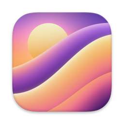</p>
<h1 align="center">Dusk Wallpaper</h1>
<p align="center">A live calendar wallpaper for the Mac.</p>

<p align="center">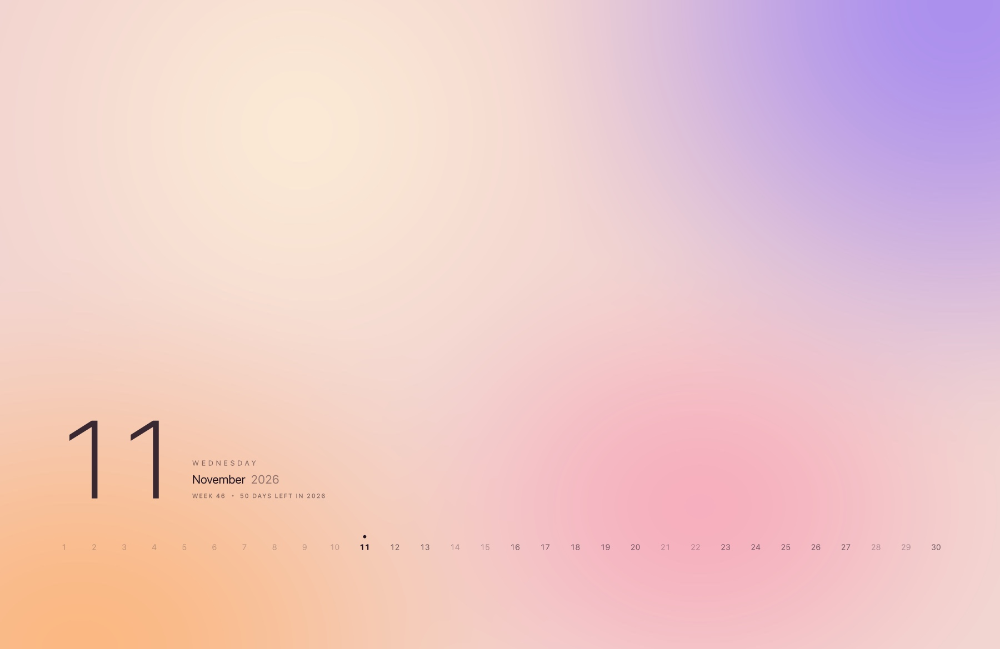</p>

<br>

<h3 align="center">The date, quietly.</h3>
<p align="center">Today, the week, and every day of the month. Low in the corner, out of the way.</p>

<br>

<h3 align="center">Colour that flows.</h3>
<p align="center">One gradient drifts into the next, all day.</p>
<p align="center">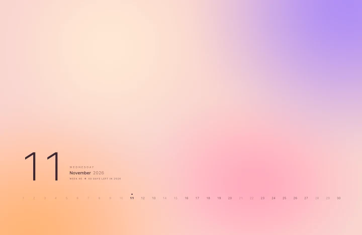</p>

<br>

<h3 align="center">Dark after dark.</h3>
<p align="center">While it flows, it follows your Mac's appearance. On Auto, it turns at sunset.</p>
<p align="center">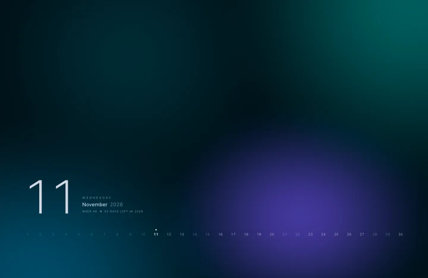</p>
<p align="center"><sub>Both clips are sped up. You set the pace, from 10 seconds to 5 minutes a gradient.</sub></p>

<br>

<h3 align="center">Six gradients. Or your own.</h3>
<p align="center">
  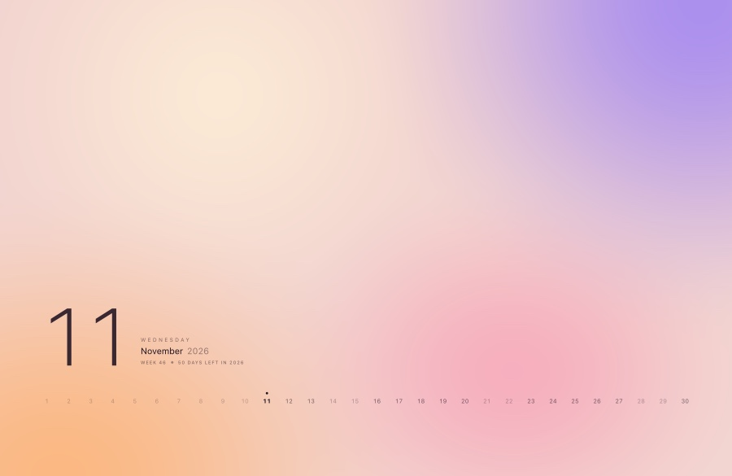
  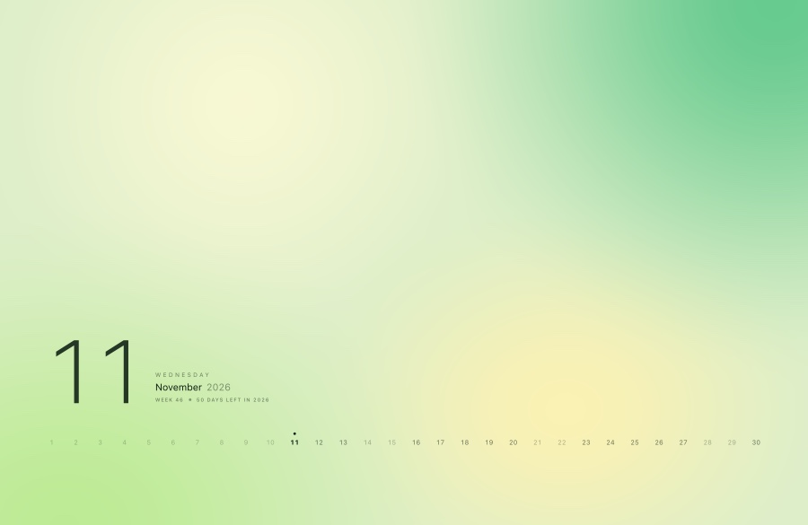
  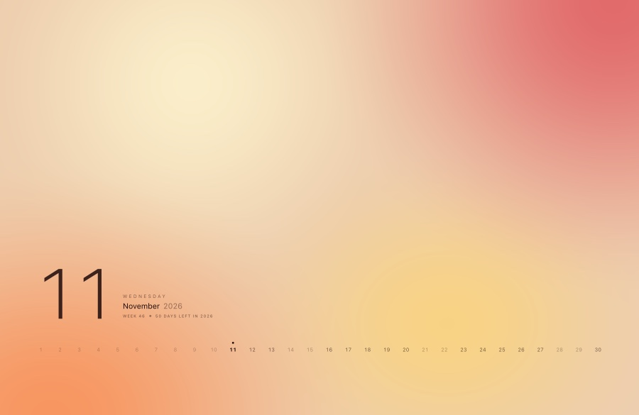
</p>
<p align="center">
  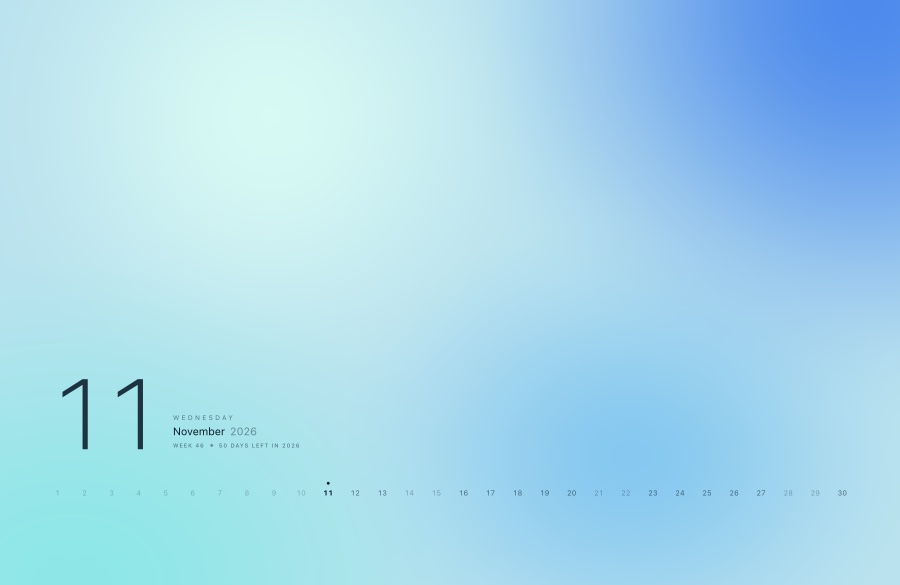
  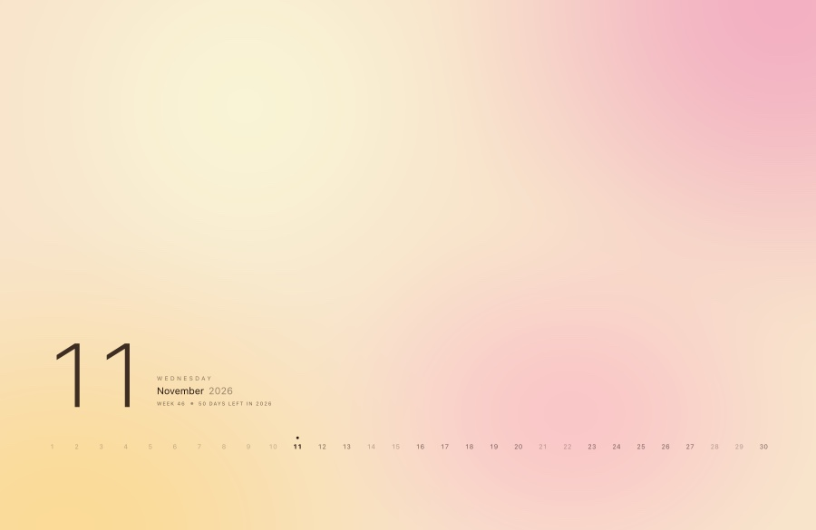
  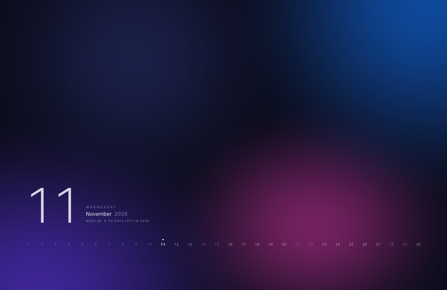
</p>
<p align="center"><sub>Dusk · Meadow · Ember · Ocean · Dawn · Night</sub></p>

<br>

<h3 align="center">Nearly weightless.</h3>
<p align="center">One Swift file. Around 30 MB of memory. Nothing running when nothing moves.</p>

<br>

## Install

**[Download Dusk Wallpaper](https://github.com/WHATDOESTHEFOXSAY2U/dusk-wallpaper/releases/latest/download/Dusk-Wallpaper.dmg)**, open it, and drag the app onto Applications.

Needs Apple silicon and macOS 14 or later. The app is not notarised by Apple, so macOS refuses to open it the first time. After that, System Settings › Privacy & Security offers **Open Anyway**.

<details>
<summary>Or build it yourself</summary>
<br>

```bash
git clone https://github.com/WHATDOESTHEFOXSAY2U/dusk-wallpaper.git
cd dusk-wallpaper/app
./build.sh
```

Needs Apple's command-line tools from Xcode 26 or later (`xcode-select --install`). The script builds the app, puts it in Applications and starts it.

</details>

## Use

Click the sun in the menu bar. Pick a gradient, or let it flow.

It starts with your Mac and stays on when you quit the app. *Turn Off Wallpaper*, in the same menu, stops it until you open the app or log in again.

<p align="center">
  <picture>
    <source media="(prefers-color-scheme: dark)" srcset="docs/settings-dark.png">
    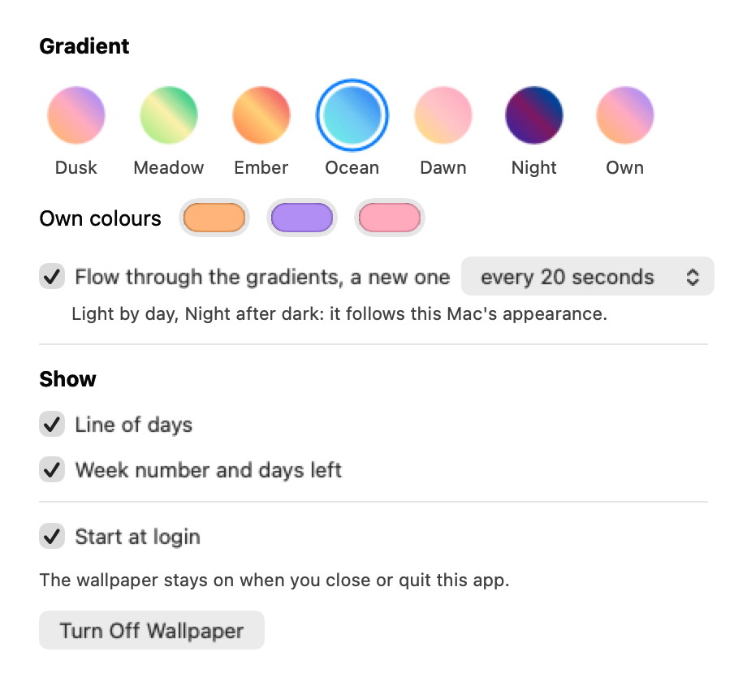
  </picture>
</p>

## Remove

In Settings, untick *Start at login* and choose *Turn Off Wallpaper*. Then move the app to the Trash.

<details>
<summary>More</summary>
<br>

**How it stays light.** The gradient is a small picture that Core Animation stretches and the graphics chip blends. The type is two small masks. No web view, no helper processes. Flowing takes a few per cent of one core. At rest, or with the desktop covered, it takes none.

**A still for your phone.**

```bash
"/Applications/Dusk Wallpaper.app/Contents/MacOS/DuskWallpaper" --render ~/Desktop/phone.png --palette night --size 393x852 --scale 3 --no-text
```

Every option is listed at the top of `app/main.swift`.

**Make the installer yourself.** `./build.sh --dmg Dusk-Wallpaper.dmg`

**Clear the settings.** With the wallpaper off: `defaults delete local.dusk.wallpaper`

</details>
